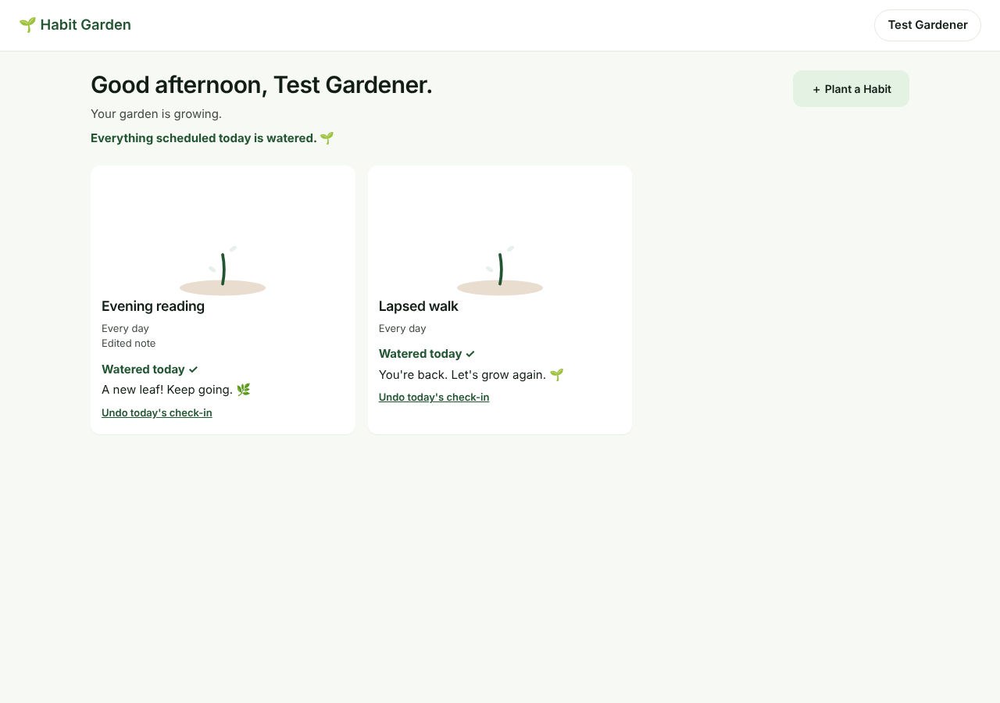

# Habit Garden

Habit Garden is a habit tracker where your habits grow into plants. Each time you check in on a scheduled day, your plant grows. Missing days makes it wilt, but never takes away what it has already grown. The garden is a summary of your real history, not a decoration.

I built it as a full-stack portfolio project to practise backend security (sessions, password hashing, ownership checks, database constraints) alongside a React front end.



## Features

- **Sign up, log in, log out** with email and password. Passwords are hashed with bcrypt.
- **Habits**: create, edit, delete. Schedules can be every day, weekdays, or custom days of the week. Past start dates are allowed.
- **Check-ins**: water a habit on a scheduled day. Duplicate check-ins are impossible, even when you click twice quickly. You can undo today's check-in.
- **Plant growth**: six stages (seed, seedling, young, growing, mature, blooming), based on how many check-ins you have made in total.
- **Wilting and recovery**: missed scheduled days make the plant wilt. Watering it again brings it back. Lifetime growth never goes down.
- **Habit detail** with recent check-in history.
- **Settings**: change password (which signs out your other devices), or delete your account, which removes all of your data.
- Responsive layout, keyboard-friendly menus and dialogs, and reduced-motion support.

## Tech stack

| Layer | Technology |
|---|---|
| Front end | React 19, Vite, React Router, plain CSS, inline SVG |
| Back end | Node.js, Express 5 |
| Database | MySQL 8 (SQL migrations written by hand) |
| Security | bcryptjs, helmet, express-rate-limit, HttpOnly session cookies |
| Tests | Node's built-in test runner, Playwright (browser checks) |

There is no TypeScript, ORM, Redux, or CSS framework. The app has few dependencies on purpose.

## Architecture

```
React (Vite dev server, or Express in production)
   │  fetch('/api/...')   with the session cookie
   ▼
Express
   ├─ requireSameOrigin   blocks cross-site state-changing requests
   ├─ requireAuth         looks up the session cookie, sets req.user
   ├─ routes              thin: validate input, call a service
   └─ services            all SQL lives here, always filtered by req.user.id
   ▼
MySQL
```

- The browser never connects to MySQL.
- The server decides everything that matters: what "today" is, whether a habit is scheduled, the plant's stage, and whether it is wilted. The front end only displays what the API returns.
- In development, Vite forwards `/api` to Express, so the browser sees one origin. In production, Express serves the built React app from the same origin, so no CORS setup is needed.

## Authentication

- Passwords are hashed with bcrypt (cost 12). Plaintext passwords are never stored or logged.
- On login the server creates a random 32-byte session token. The browser receives it in an **HttpOnly, SameSite=Lax** cookie (`Secure` in production). The database stores only its SHA-256 hash.
- Logging out, expiring, or changing your password deletes the matching session rows, so an old cookie stops working immediately.
- Login failures return the same message for a wrong password and an unknown email, and the server runs a bcrypt comparison either way, so response timing does not reveal which emails are registered.
- Signup and login are rate-limited per IP.
- Every habit route requires a session. Ownership is enforced in SQL (`WHERE user_id = ?`), and a habit that belongs to someone else returns the same 404 as one that does not exist.

## Database

| Table | Purpose |
|---|---|
| `users` | Name, email (unique), bcrypt hash, IANA timezone |
| `sessions` | Hashed session tokens, expiry, owner |
| `habits` | Name, description, category, frequency, weekday bitmask, start date |
| `check_ins` | One row per habit per day. `UNIQUE (habit_id, check_date)` blocks duplicates |

Deleting a user or habit cascades to its sessions, habits, and check-ins (`ON DELETE CASCADE`). The schema is in `server/src/db/migrations/001_init.sql`.

## How the plant works

- **Stage** comes from the total number of check-ins ever made: 0 = seed, 1 = seedling, 4 = young, 10 = growing, 20 = mature, 40 = blooming. These thresholds are in `server/src/config/plant.js`. Missed days never lower the stage.
- **Wilt** looks only at scheduled days in the last 7 days, up to yesterday. Today is never counted as missed, because the day is not over. Days before the habit started and unscheduled days are not counted. One missed day is a slight wilt. Two or more is a full wilt.
- **Recovery:** checking in today restores the plant's appearance immediately. The history of misses is kept.
- **Time zones:** each user has an IANA timezone, and "today" is calculated from it on the server. Dates are stored as calendar dates (`DATE`), not timestamps, so a check-in cannot land on the wrong day.

## Running it locally

**Requirements:** Node.js 20 or newer, and MySQL 8 (MariaDB works for local testing).

**1. Create the database and user** (in the MySQL shell, as an admin user):

```sql
CREATE DATABASE habit_garden CHARACTER SET utf8mb4 COLLATE utf8mb4_unicode_ci;
CREATE USER 'habit_garden_app'@'localhost' IDENTIFIED BY 'choose-a-strong-password';
CREATE USER 'habit_garden_app'@'127.0.0.1' IDENTIFIED BY 'choose-a-strong-password';
GRANT ALL PRIVILEGES ON habit_garden.* TO 'habit_garden_app'@'localhost';
GRANT ALL PRIVILEGES ON habit_garden.* TO 'habit_garden_app'@'127.0.0.1';
FLUSH PRIVILEGES;
```

**2. Configure the server:**

```bash
cd server
cp .env.example .env     # then set DB_PASSWORD to the password you chose
npm install
npm run migrate          # creates the tables; safe to run again
npm run dev              # API on http://localhost:3001
```

**3. Start the front end** in a second terminal:

```bash
cd client
npm install
npm run dev              # app on http://localhost:5173
```

Open http://localhost:5173, sign up, and plant your first habit.

### Environment variables

Set in `server/.env` (see `server/.env.example`). Never commit this file.

| Variable | Purpose |
|---|---|
| `NODE_ENV` | `development` or `production`. Production turns on `Secure` cookies and serves the React build |
| `PORT` | Port for the API (default 3001) |
| `APP_ORIGIN` | The address the app is served from. Requests that change data must come from here |
| `DB_HOST`, `DB_PORT`, `DB_USER`, `DB_PASSWORD`, `DB_NAME` | MySQL connection |
| `SESSION_TTL_DAYS` | How long a login lasts (default 14) |

## Tests

```bash
cd server
npm test                 # 45 backend tests: habits, check-ins, plant rules, auth, account
```

The backend tests use the database in `server/.env` and remove the users they create. The browser checks (Playwright with Chromium, run from outside the project) cover the main user journeys. They are not part of `npm test`.

## Production build

```bash
cd client
npm run build            # output in client/dist
```

Express serves `client/dist` when `NODE_ENV=production`. Deployment is not set up.

## Decisions and trade-offs

- **Hand-written SQL and migrations instead of an ORM.** The queries are short, and writing them directly makes the ownership checks and constraints easy to see.
- **Server-side sessions in MySQL instead of JWTs.** Logging out and password changes can take effect immediately. The cost is one database lookup per request, which is fine at this scale.
- **Plant state is calculated, not stored.** There is no `plant_state` column to fall out of sync with the check-in history.
- **Duplicate check-ins return 200, not an error.** Double-clicks and retries are harmless.
- **Missed-day wilt looks at the last 7 days only.** A plant left alone for longer than a week looks healthy again, but its growth is still there. This is a deliberate choice to avoid punishing people, and it is easy to change.
- **Duplicate-email signup returns a clear error.** This reveals that an email is registered. I accepted that for a clearer sign-up experience.
- **Delete account requires the password again**, so a left-open browser cannot delete the account.

## Out of scope

Google sign-in, password reset by email, email confirmation, a list of signed-in devices, notifications, analytics, deployment, and a mobile app.

## Known limitations

- Tested in desktop Chromium and at phone, tablet, and desktop widths. Other browsers and real devices were not tested.
- Fonts are loaded from Google Fonts. Without internet access the app falls back to system fonts.
- The check-in history shows the last 90 days only.
- The plant art is hand-drawn SVG. It is simple by design.
- The rate limiter stores its counts in memory, so it resets when the server restarts. It is not shared between servers.
